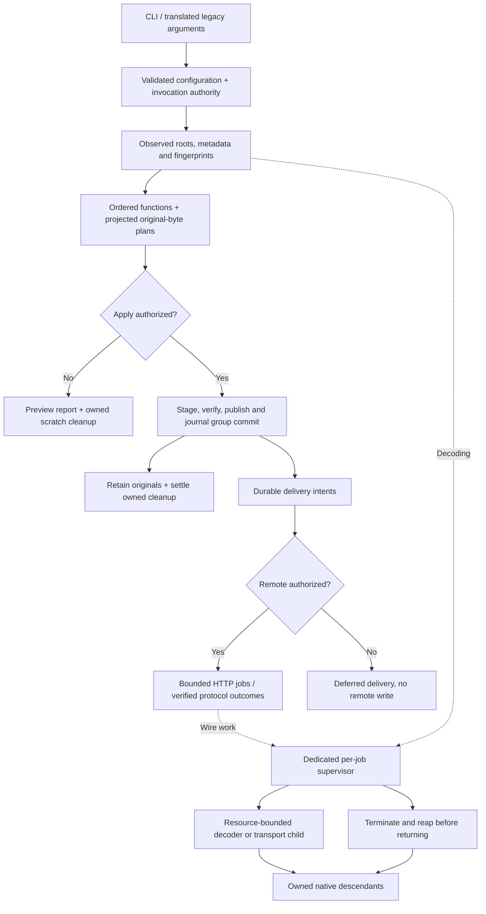

# Komga Cover Extractor

Installed, function-first workflows for book metadata, archive conversion, artwork, organization, release checks and independently supervised watch/torrent services. Local changes use observed fingerprints, explicit plans and a durable publication journal; remote delivery is separate from file publication.

## Install

The current development runtime is normal-GIL CPython 3.14.6 on Linux x86_64. Other platforms are not verified. Native decoder and process-supervision paths require Linux.

```sh
uv sync --locked --all-extras --group legacy
uv run --locked --no-sync kce --help
uv run --locked --no-sync kce doctor
```

For a normal installation, use the built wheel or install the project:

```sh
python -m pip install '.[all]'
kce --help
```

Optional extras are `covers`, `watch`, `image-similarity`, `conversion` and `integrations`; `all` selects the declared extras. Core inspection must not require unrelated heavy dependencies. Native RAR extraction requires licensed `unrar`; installing a Python wrapper is not proof that the decoder is available. Optional manga ISBN and EPUB-converter add-on sources/assets are absent: enabling those modes produces an explicit missing-input failure, not a successful fallback.

## Configuration and authority

Select TOML only with `--config`. Precedence: built-in defaults, explicit TOML, `KCE_*` environment, then explicit CLI options. Relative TOML paths resolve from its directory; relative CLI paths resolve from the invocation directory. The application does not change global working directory or discover a hidden mounted configuration file.

```toml
paths = ['/books/library']
download_folders = ['/books/downloads']
state_dir = '/state/journal'
log_dir = '/state/logs'
manual_rename = false
manual_delete = false
log_to_file = true
extract_covers_toggle = true
output_covers_as_webp = true
compress_image_option = false
```

Mutating commands **preview by default**. Local writes need `--apply`. Remote effects need `--allow-remote`; removing a torrent additionally needs `--allow-torrent-removal`. Torrent deletion always sends `deleteFiles=false`. Settings and Docker environment values cannot grant mutation authority. Manual choices require `--interactive` and a real terminal; unattended ambiguity is review-required.

State belongs on supported local storage, outside protected media inputs when practical. Journal transactions do not make filesystem publication atomic to external readers. A verified group commits before cleanup; originals are retained for recovery. Custom artwork and externally replaced targets are not guessed away.

## Commands

| Command | Work |
|---|---|
| `inspect-config`, `doctor` | Redacted effective configuration and local capability diagnostics |
| `inspect` | Read selected archive metadata and source identity |
| `extract` | Plan/apply book and eligible series artwork |
| `convert` | Verified native archive conversion and source retention |
| `organize`, `duplicates` | Configured naming, folder matching, routing, ranked duplicate/upgrade decisions |
| `missing-releases` | Local numeric gap reports |
| `rename-lists` | Literal dictionary import and maintenance |
| `releases` | Read-only BookWalker observation and local comparison |
| `run` | Complete configured ordered workflow |
| `recover` | Inspect/reconcile one durable operation |
| `watch` | Bounded readiness/event intake through the same workflow |
| `qbit` | Independent torrent selection and separately authorized effects |
| `serve` | Supervise run/watch and an optional independent torrent helper |
| `migrate-config` | AST-only translation of literal historical settings |

```sh
kce --config /config/config.toml inspect --json
kce --config /config/config.toml extract --json
kce --config /config/config.toml extract --apply --json
kce --config /config/config.toml run --json --plan-output /reports/run-plan.json
kce --config /config/config.toml run --apply --profile /reports/run.prof
kce --config /config/config.toml recover OPERATION_ID --json
kce --config /config/config.toml recover OPERATION_ID --apply --json
kce --config /config/config.toml watch --once --json
kce --config /config/config.toml qbit --once --json
```

Named plan/profile output is exclusive and must be outside configured media/state/log paths and explicit input parents. Profiling is supported for `run` and `extract` and executes the actual selected service. Ordinary machine output is JSON; watch streams `job` records and a final `summary` as JSONL. Diagnostics/readiness go to stderr. SIGINT/SIGTERM preserve counts and return 130/143.

### Execution boundaries



No service/repository hierarchy or duplicate transport DTO layer is required. Each untrusted job has a dedicated supervisor that alone adopts and reaps its decoder's descendants; the embedding caller's signal/subreaper state is unchanged. Recovery state and immutable domain values remain explicit because they carry real safety invariants.

## Migration

`komga_cover_extractor.py` and the historical qBittorrent add-on are stdlib-only guarded launchers into the installed package using the same interpreter and isolated module execution. They no longer import the executable root script or mutate `sys.path`. Install first; there is no legacy fallback. `tests.py` runs modern pytest checks; original characterization is separate.

Literal settings migration never imports or evaluates `settings.py`. Remove retired `cache_each_root_for_each_path_in_paths_at_beginning_toggle` and `short_word_filter_percentage` from canonical configuration. Fresh inventories replace trusted persisted path caches; the old shortened-word slices had no decision effect. Safe legacy migration validates and omits its historical cache boolean. The misspelled historical restructure setting is translated at the migration boundary.

Missing default series artwork is still `cover` only. `cover`/`poster` are recognized roles, not an instruction to create both. Ownership is content/journal based rather than mtime based. Encoded image formats determine filename suffix and MIME. A complete Komga URL may supply its own port with `komga_port = ''`.

Bare qBittorrent hosts such as `127.0.0.1` retain the legacy HTTP default; explicit HTTP(S) URLs remain supported. Connect, read and BookWalker timeout settings are capped at 60 seconds. Recovery reports newly committed groups, so completed or cleanup-only recovery reports zero without dropping independently pending delivery.

Watch bounds active negative-cache, pending and review work. Completed journal history is retained without an automatic purge. Keep the state store and retained originals on supported local storage.

See [behavior changes](docs/refactor/BEHAVIOR_CHANGES.md), [settings migration](docs/refactor/SETTINGS_MIGRATION.md), [symbol ownership](docs/refactor/SYMBOL_MIGRATION.md), and [recovery verification](docs/refactor/VERIFICATION.md). Frozen originals are under `tests/fixtures/legacy/`; do not regenerate them to match modern behavior.

## Container and release proof

The Docker entrypoint executes the installed program, preserves runtime UMASK and runs as a non-root application user. Keep `/books`, `/config` and `/state` separate; configuration selection is still explicit `--config`. The default `serve` invocation does not authorize mutation. Original Docker uppercase inputs are translated below native KCE values and explicit CLI overrides. Missing licensed add-on build modes fail by name before building a fake implementation.

Current artifact, platform, corpus, benchmark and integration results are in [verification evidence](docs/refactor/VERIFICATION.md) and [status](docs/refactor/STATUS.md). Historical passing gates are not proof of later edits. Localhost protocol fixtures are not live-service or live BookWalker DOM verification; local Linux filesystems are not NAS/NTFS/macOS/ARM64 evidence.

## Development

```sh
uv run --locked --all-extras --group legacy pytest tests --tb=short
uv run --locked --all-extras mypy src tools
uv run --locked ruff check src tools tests --exclude tests/fixtures/legacy
python3 tools/export_requirements.py --check
sh tools/verify_deployment.sh /tmp/kce-new-proof-directory
```

Use a new proof directory. Keep fast behavioral tests, the complete frozen corpus, installed-wheel checks, real container lifecycle checks and the paired parser benchmark separate. No unsupported whole-application speedup claim follows from a parser benchmark.

## License and support

[MIT license](LICENSE.md). Report reproducible issues with redacted configuration, exact commands and observed outcomes; do not attach credentials or personal library contents.
