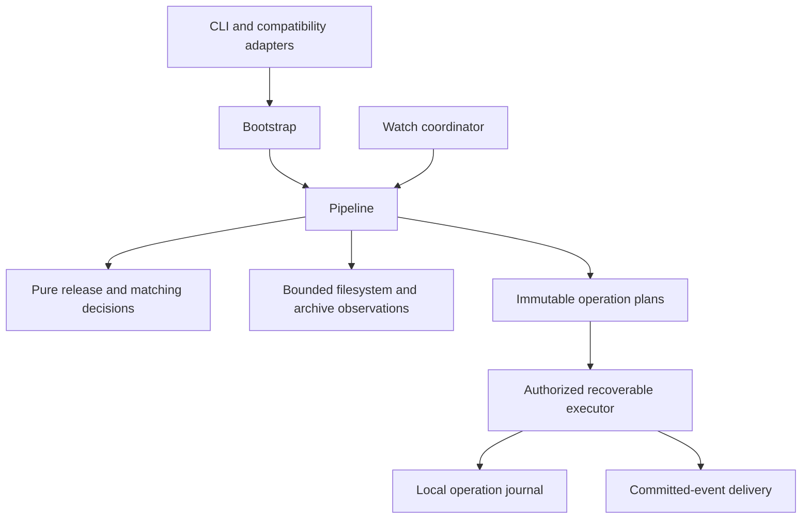
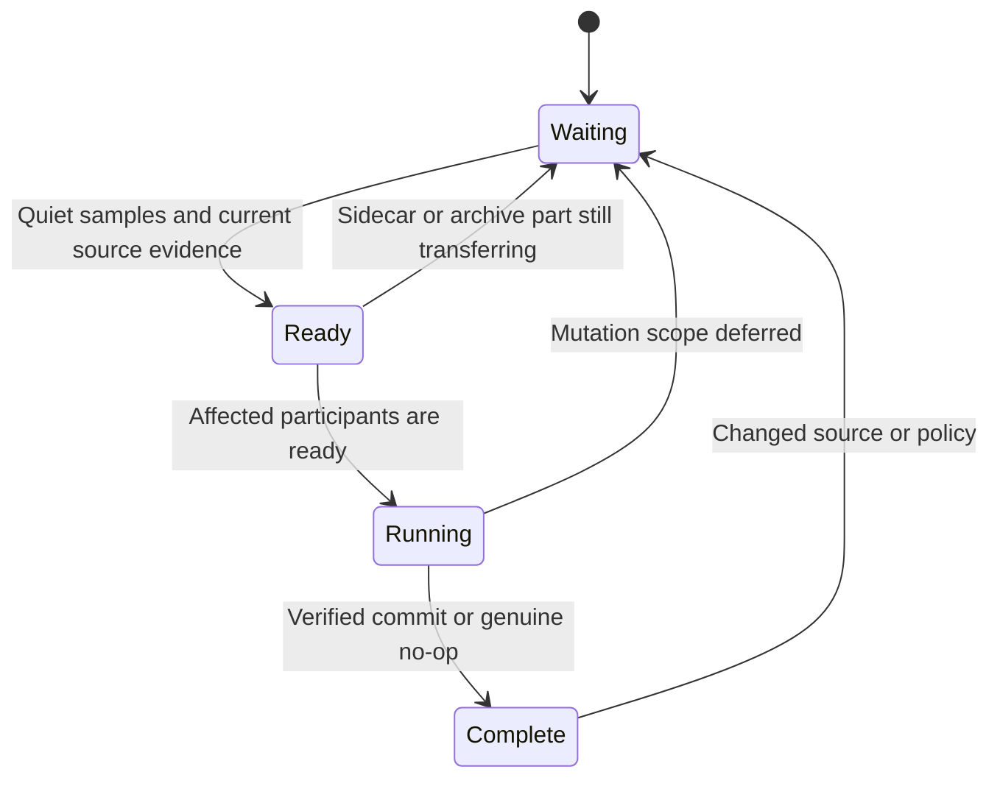

# Application boundaries

The application uses one package and one pipeline. CLI adapters and the watch coordinator construct a `RunRequest`; bootstrap owns the pipeline's resources. Parsing, matching and policy values do not own filesystem or network effects. The historical monolith is not shipped as a second implementation or runtime fallback.

## Values and identity

`ReleaseNumber` distinguishes missing, scalar, contiguous range and explicit set. Decimal values come from source tokens rather than binary floats; raw tokens preserve presentation precision. Part is separate from the release number, so part 12 cannot alias volume + 1.2. Originally accepted zero and fractional chapter parts remain valid; integer parts serialize as integers and fractional parts as exact decimal strings. Renaming retains the original source-span grammar: an unrecognized fractional `x` span is left unchanged, not partially rewritten. Expansion is bounded and semantic comparison is explicit, not dataclass ordering across incompatible number kinds.

Renaming keeps `_extra` attached to its original range endpoint while ordering the range. A descending `v3-1_extra` renders as `v01_extra-03`; reparsing preserves coverage and part identity.

`FileObservation` supplies siblings, root role, metadata, page/grayscale observations and optional fingerprint. `ReleaseSnapshot` is frozen but uses identity equality, preserving the original distinction between two separately observed files. Path, content and semantic deduplication use explicit keys. Name, stem and parent derive from the observed path rather than independently mutable fields.

Library containment uses components, not substring matching. Identical physical root roles can merge; conflicting restrictions and nonidentical nested roots are rejected. Remote paths use explicit longest-prefix mappings; local drive letters are never stripped to guess server paths. Pure path functions do not resolve symlinks; the I/O boundary rejects observed symlink components.

## Effects and result contracts

An `OperationPlan` is data, not executable code and not permission. It names schema/policy versions, operation ID, ordered member dependencies, configured-root permissions, observed fingerprints, destination collision decisions and artifact specifications. Supported member kinds are publish, move, quarantine, mkdir and rmdir. Arbitrary callbacks/commands do not belong in serialized plans. Generated artifact bytes are omitted from normal plan presentation; internal persistence may retain the data needed for recovery.

`RunAuthorization` separates local apply, remote effects and torrent removal. None is implied by another or loadable from configuration. `RunResult` separates plans, committed groups, skipped/failed work and deferred delivery. Exit codes are 0 completed/preview, 1 operational failure, 2 invalid input or missing capability, and 3 conflict/review/stale/cancelled/deferred work. Remote failure cannot turn an already committed local operation back into a pending file mutation.

Archive, image and HTTP jobs launch one dedicated supervisor interpreter. That supervisor alone enables Linux subreaper ownership, forks a resource-limited decoder and terminates/reaps attached or adopted detached descendants before returning. The embedding application's subreaper flag and unrelated `Popen` children remain untouched. Cancellation targets the owned supervisor; successful launch remains the conservative remote-dispatch uncertainty boundary. Procfs/Linux ownership is required, and uninterruptible kernel tasks cannot be promised timely reaping.

## Verification boundary

Configuration and value contracts have unit and real CLI checks. Publication tests exercise actual bytes, durable state, process crashes and fresh recovery. Generated review reports and copied legacy programs are not product inputs. Deployment checks build and exercise the current installed package and container.

## Cover and artwork ownership

`extract_cover` performs archive and raster work in the owned archive worker. `CoverPolicy` contains the effective selection, chapter, blank-filter, and encoding settings. `ByteOutputPolicy` and `FileOutputPolicy` select output modes. Neither mode publishes a sidecar.

Comic discovery sorts validated raw archive-member names; reads still use safe canonical paths. EPUB discovery uses the exact authoritative member returned by the package resolver; unrelated raw first-page images are not decoded during inspection or extraction. Only positive blank detection permits ordered fallback after valid authority; missing, unsafe, ambiguous, or invalid authority never falls back. Non-authoritative discovery retains regex order and the original pattern-pass behavior after a blank match.

File mode preserves correctly labeled JPEG and PNG bytes when no transformation is requested. `.jpeg` output normalizes to `.jpg`. Requested WebP always transcodes, including when compression is off. A WebP source requested as ordinary file artwork becomes JPEG. File re-encoding uses `image_quality` and optimization. Byte mode always re-encodes with `return_data_image_quality`, without optimization, and returns the actual codec identity.

Transformed JPEG composites transparency onto white. Transformed rasters apply EXIF orientation once and strip EXIF. ICC survives only when the profile is valid and the color space is unchanged. Animated, corrupt, oversized, and encoder-failed images produce typed failures, never original-byte success fallbacks.

`compare_cover_bytes` supervises matching input through the same worker. The worker retains the characterized OpenCV 400-by-600 `INTER_AREA`, channel reconciliation, grayscale, histogram equalization, normalization, and SSIM pipeline. Missing comparison extras or packaged blank references are capability failures.

`plan_series_artwork` consumes `SeriesArtworkObservation` rather than scanning directories. First and latest selection retain exact part and collection membership, including a unique qualifying one-shot. Chapter copying uses configured matching thresholds, requires one explicit matched or mapped library/both-role volume series and a qualifying volume-one source, and checks both chapter gates before copying or extraction. Download-only volume folders are not standalone chapter-art sources. Archive-observed classification survives folder reconstruction; filename-only assessments cannot bypass current page-count classification. Mixed-series folders require review. Subfolders and configured download-root placement prevent series-art creation.

Artwork equality uses observed SHA-256, even when timestamps match. Custom cover and poster artwork remains untouched unless its bytes are already identical. Recorded generated artwork can be updated. Cross-extension decisions retain old artwork and name cleanup only after the replacement commits. New series artwork uses the legacy cover-only creation default. Existing recorded poster roles remain associated and can update with their owning book.

`check_book_artwork_collisions` detects archives sharing a sidecar stem before publication. Artwork decisions identify the source book, source image, destination, retained candidates, and post-commit cleanup. The pipeline converts these decisions into grouped executor operations.

## Readiness and bounded work

Watch requests carry exact ready source fingerprints, not path-only authority. Unready downloads remain in physical catalogs for collision checks but cannot become ranked keepers or mutation sources. Compiled plans fence original sources, replaced destinations, and original artifact inputs, including recorded series artwork; fresh owned workspace artifacts are not mistaken for downloads. Sidecar, folder, and multipart effects require every actual participant; unrelated ready books need not wait for a whole connected series. Native archive readers identify real multipart dependencies, and associated files receive bounded quiet sampling without consuming one active pipeline job per part.

Readiness precedes dispatch. Incomplete or nonprimary multipart observations wait for their primary instead of spending decoder retries. Completed publication is durably deduplicated by exact fingerprints; restoring uncommitted observations requires fresh sampling. Hidden owned workspaces are excluded before directory reconciliation. Interactive approvals use one cancellation-aware, bounded line reader.

Each decoder still has an owned supervisor. A run-local header observation is reused between correction and conversion. With no organizer action enabled, cover-only `run` omits an unused post-artwork organizer pass; it retains bounded artifact spilling, fingerprint checks, staging, fsync, and journal recovery.
