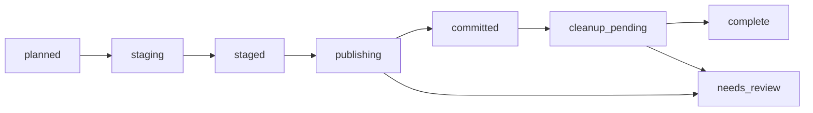

# Publication and recovery

All local mutations require invocation-level `--apply`. A plan contains observations and intent, not authority; configured roots authorize paths again at execution. Preview performs validation but creates no journal, lock, stage, quarantine or default log. `--plan-output` is a separate exclusive output exception.

The executor stages all publication/move members before publishing any, preserving rename-cycle source bytes. Stages and retained originals use owned paths on the destination/original filesystem. New absent targets use hard-link no-clobber publication. Unsupported hard links fail closed; no check-then-replace fallback is used. Replacements require observed prior content and an independently copied, verified, flushed backup before `os.replace`. Source cleanup is separately journaled after verified group commit and retains an independent quarantine copy. No automatic quarantine purge is implemented.



A book/sidecar/series-artwork group is recoverable, not an atomic multi-file rename. The journal records per-member stages, backups, published fingerprints and cleanup obligations. Local commit events are inserted only after verified group publication; repeated recovery does not insert a second event. Remote delivery is a separate obligation and must never republish books.

## Recover an interrupted operation

```sh
kce --config config.toml recover OPERATION_ID --json
kce --config config.toml recover OPERATION_ID --apply --json
```

Preview reports journal state without repair. SQLite is opened read-only, including when a crash left a hot rollback journal; if database repair is necessary, preview reports an explicit state error and leaves database/journal bytes unchanged. Authorized recovery acquires the state ownership lock before a writable SQLite open can perform native rollback. Schema one rejects unsupported schema objects/versions and checks the durable state identity sidecar. Journal and locks must belong to the same state store and recorded operation. A live writer cannot be displaced by another recovery, and refusing its lock must not change its journal phase or error.

Non-recovering state preparation uses the same lock-before-SQLite path and refuses an abandoned operation owner. A dictionary source authorized only for reads is fingerprinted/revalidated but never becomes a writable lock location. If writable state is nested beneath that source, only the explicit writable child boundary may host its transaction lock.

Recovery checks target/stage/backup/source identities. It resumes only validated pending work. Changed candidates remain for review; it does not infer ownership from a familiar filename. Recovered copies are flushed again before use or source removal. Where restoration is possible, the old content is copied to a separately owned temporary file rather than linking the retained backup into the live writable target; the new candidate is retained first. A newly modified source cannot cause rollback to destroy its previously observed bytes.

Counts measure newly committed groups during the invocation. Completing an unfinished group reports one; completed and cleanup-only recovery report zero. Existing commit events and independently authorized pending delivery remain durable without republishing files.

The executor's staged-byte budget uses the configured conversion scratch allowance. Reservations include publication artifacts, replacement backups and retained move/quarantine sources; crossing the allowance is refused before creating state. Streaming additionally refuses source growth beyond observed length/cap before writing the excess chunk. A lowered budget may prevent an existing pending operation from continuing; preserve candidates and restore the intended limit before attempting recovery.

## Watch readiness and replay

Completed watch work and committed output artifacts retain exact-fingerprint, policy-scoped durable suppression. Restart does not republish unchanged completed books. Uncommitted waiting/ready observations restart their quiet window; old persisted readiness is not mutation authority. Completed peers reused as decision evidence are freshly sampled and checked against current fingerprints and downloader state.

Growing or unfinished peers cannot authorize duplicate retirement. Sidecar and folder effects defer until their actual sources are ready, as do real multipart dependencies. Dependency waits do not consume archive-decoder retry attempts. Other decoder failures retain bounded retries. Active jobs, auxiliary samples, and readiness caches remain bounded; evicted multipart associations are freshly observed before dispatch. A multipart snapshot exceeding the configured dependency capacity remains intact for explicit review, not an endless wait or expanded authority.

SIGINT/SIGTERM interrupts pending terminal approvals without requiring input and leaves uncommitted candidates intact. Retained originals, committed groups, and independent delivery obligations keep their existing recovery contracts.

## Unsent torrent actions

Producer-confirmed local failures before a mutation was dispatched remain retryable. A fresh authorized attempt re-observes torrent/files, server version, policy, library evidence, and cancellation before sending an effect. Historical failed rows with a validated known-unsent error use an atomic claim over the exact previous payload and error; a competing claimant cannot be overwritten. `pending_unknown = false` alone is insufficient because received HTTP rejections also use it. Sent rejections and ambiguous outcomes retain their existing non-replay/reconciliation behavior. Torrent removal still requires separate permission and always requests `deleteFiles=false`.


## Tested and residual limits

Linux x86_64/Python 3.14 temporary filesystems: process termination after publication/backup/group commit/cleanup boundaries, competing writer/recovery, no-clobber unsupported faults, file/directory flush faults, nested directory removal, retained copy independence, malformed schemas and hot-journal preview preservation have regression coverage. An actual `/tmp` to `/dev/shm` move exercised distinct devices; a separate test injects EXDEV semantics. Real CLI recovery also passed outside the checkout using the clean installed wheel, including occupied cyclic paths and connected delivery.

Cooperating instances must share the configured local state directory. POSIX flock serializes cooperating writers; it is not distributed locking and cannot prevent external applications from changing paths. Path component/symlink/fingerprint revalidation narrows but does not eliminate the final external-writer TOCTOU window. Required file and parent-directory fsync must succeed for durable publication. NAS/FUSE/SMB/NFS and non-Linux behavior are not verified by these local checks. Keep backups and the journal when durability or identity is uncertain.
